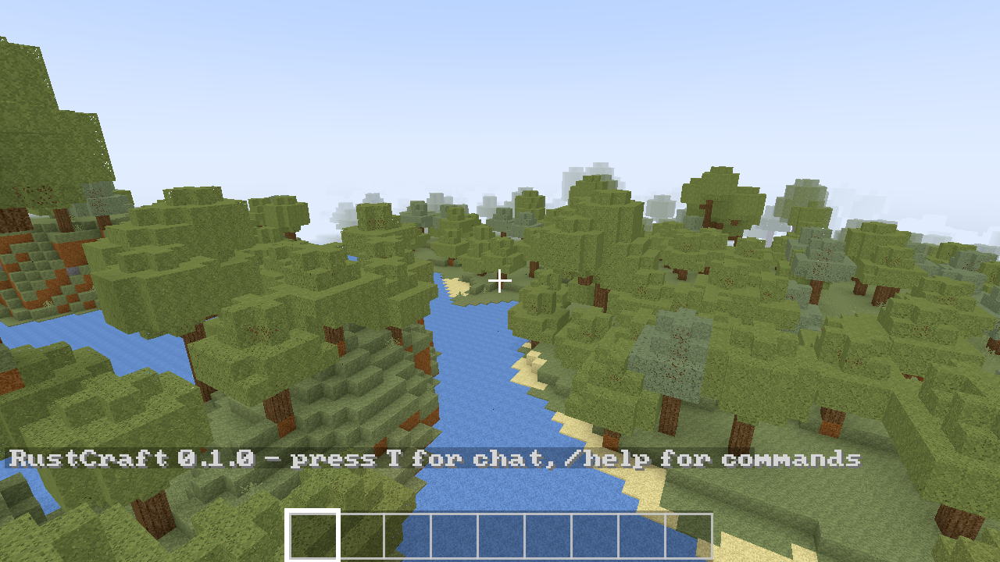
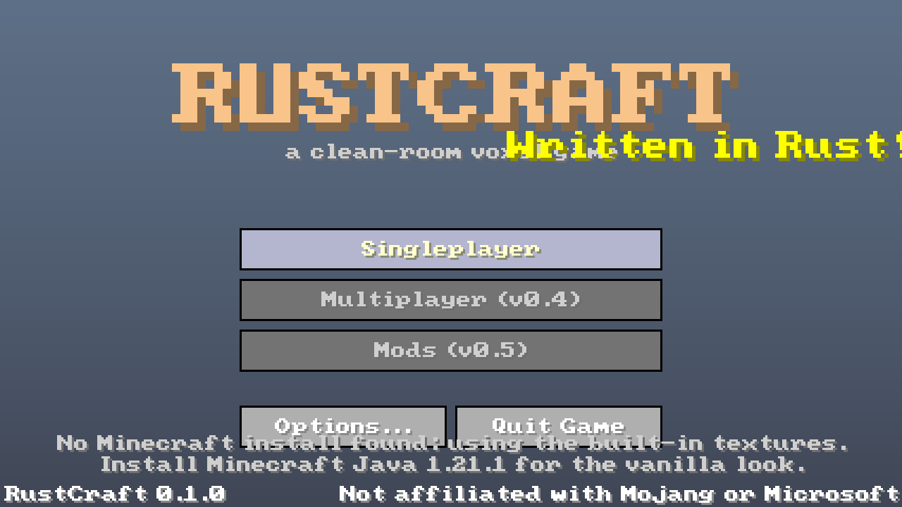
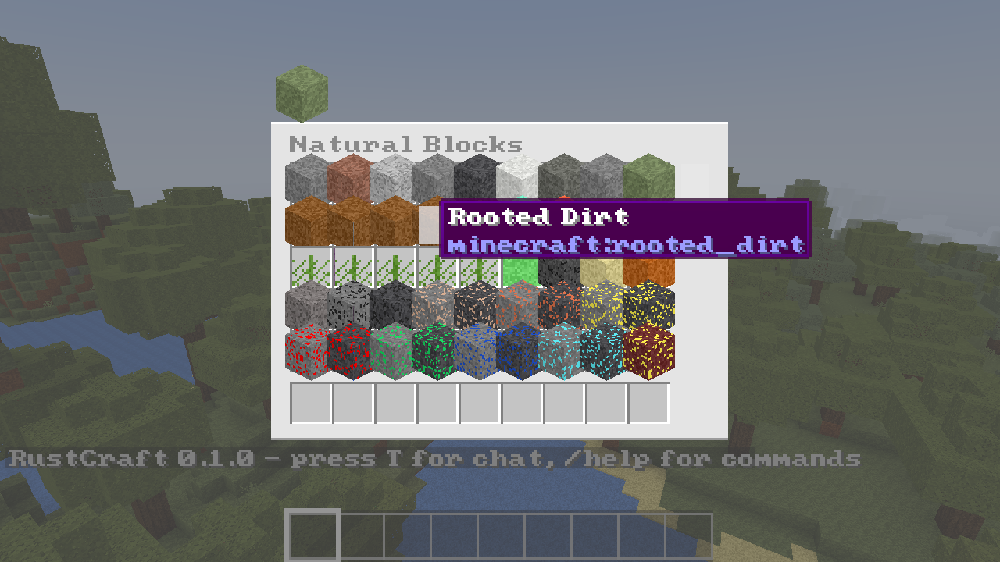
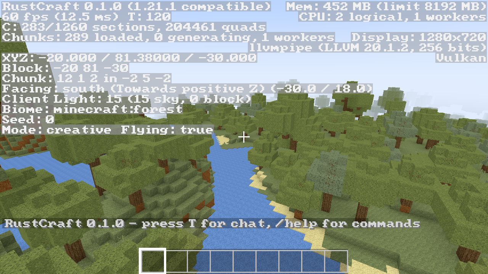
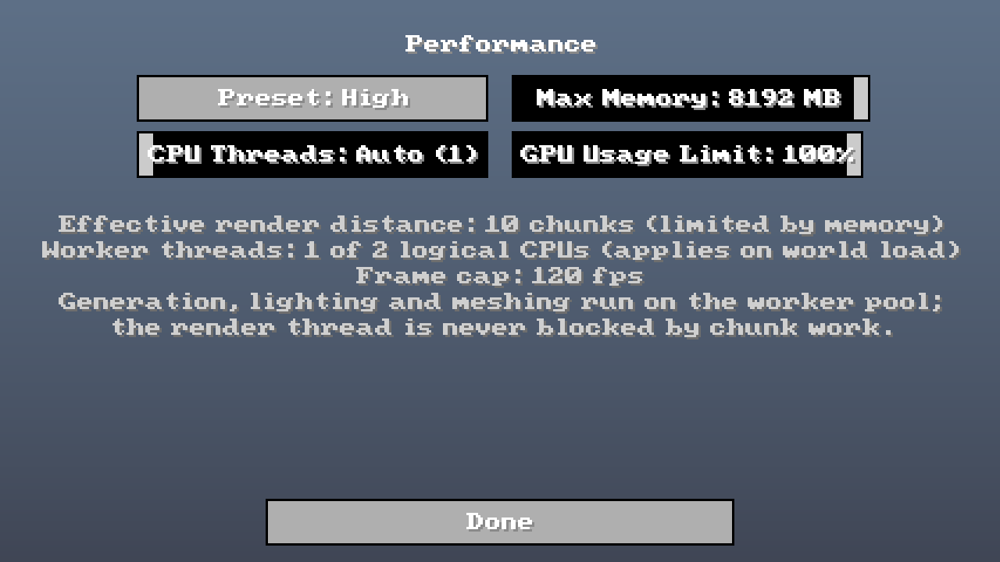

# RustCraft

A clean-room reimplementation of **Minecraft: Java Edition 1.21.1** in Rust —
fast, multi-core, GPU-first, and built to run from a Core 2 Duo laptop in under
1 GB of RAM up to a 16-core desktop with 96 GB.

> Status: **v0.1.0 — Phase 1 (core engine).** One seed-exact world you can
> explore, mine and build in with naturally generated blocks.
> See [`docs/ROADMAP.md`](docs/ROADMAP.md) for the plan and
> [`docs/ARCHITECTURE.md`](docs/ARCHITECTURE.md) for how it fits together.



## What works in 0.1

- **Seed-exact vanilla 1.21.1 terrain**: biomes, terrain noise, caves, aquifers,
  ore veins, surface rules, carvers and almost every overworld feature (trees,
  ores, vegetation, lakes, geodes, dripstone, lush caves…). Typing a seed you use
  in vanilla gives you the same world. Checked in CI against chunks saved by the
  real game.
- **Rendering** with vanilla block models and blockstates, smooth lighting and
  ambient occlusion, biome tints, animated textures, water, sky, sun, moon,
  clouds and fog, render distance 2–32.
- **Gameplay**: survival / creative / spectator, vanilla movement physics,
  breaking with vanilla hardness timing, placing with orientation rules,
  inventory, creative tab of every naturally generated block with search,
  chat and commands (`/help`).
- **Vanilla-style UI** at vanilla GUI scales: title, world select and create,
  options (video, performance, controls, updates), pause, loading, death,
  HUD, F3 debug screen.
- **RCW** — RustCraft's own checksummed, append-only, zstd world format.
- **Resource limits you control in game** (Options → Performance): maximum
  memory, CPU worker threads and GPU usage, plus Potato → Ultra presets.
- **Self-update** from GitHub Releases (Options → Updates: automatic, ask, off).

## Getting started

Download `rustcraft-0.1.0-windows-x86_64.exe` from the
[latest release](https://github.com/goglesquirmintontheiii/rcraft/releases/latest)
and run it — it is portable, nothing is installed. Put a file named
`portable.txt` next to the exe to keep saves and settings in a
`rustcraft-data` folder beside it instead of `%APPDATA%\.rustcraft`.

**Textures, fonts and GUI art come from your own Minecraft install.** If you
have Minecraft Java 1.21.1 installed (launch it once so the 1.21.1 jar is
downloaded), RustCraft finds it automatically. Otherwise it uses its own
built-in procedural textures. You can also point it at a jar or extracted
assets folder with `--assets <path>` or the `RUSTCRAFT_ASSETS` variable.

### Controls

| Action | Key |
|---|---|
| Move / jump / sneak / sprint | W A S D / Space / Left Shift / Left Ctrl or double-tap W |
| Fly (creative) | double-tap Space |
| Break / place / pick block | Left / Right / Middle mouse |
| Inventory · chat · command | E · T · / |
| Hotbar | 1–9, mouse wheel |
| Debug · hide HUD · screenshot · fullscreen | F3 · F1 · F2 · F11 |

## Building

```sh
cargo build --release -p rustcraft          # the game
cargo test --workspace                       # tests (includes the seed-parity suite)
cargo run --release -p rustcraft -- --screenshot out.png --scene world --seed 0
                                             # headless render (lavapipe is fine)
```

Linux build deps: `libxkbcommon-dev libwayland-dev libasound2-dev libudev-dev`.
For headless rendering in containers: `mesa-vulkan-drivers`, then
`WGPU_BACKEND=vulkan VK_ICD_FILENAMES=/usr/share/vulkan/icd.d/lvp_icd.json`.

## Screenshots

Repository screenshots use the built-in fallback textures so that no Mojang art
is redistributed; with your own install the game uses the vanilla look.

| | |
|---|---|
|  |  |
|  |  |

## Legal

RustCraft is not affiliated with Mojang or Microsoft. It ships **no** Mojang
assets; for vanilla textures, sounds and fonts it reads your own legally owned
copy of the game. See [`docs/CLEAN_ROOM.md`](docs/CLEAN_ROOM.md).

Code: MIT OR Apache-2.0. Bundled original assets: CC0. The fallback font is
the public-domain font8x8 (IBM PC BIOS glyphs).
